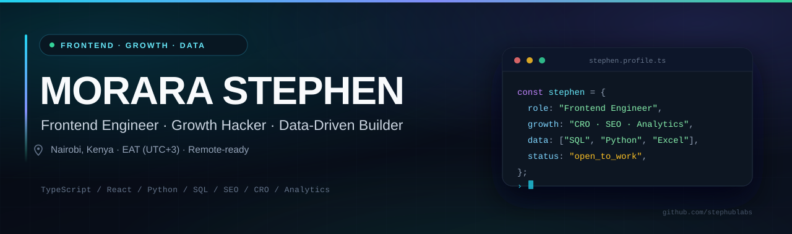
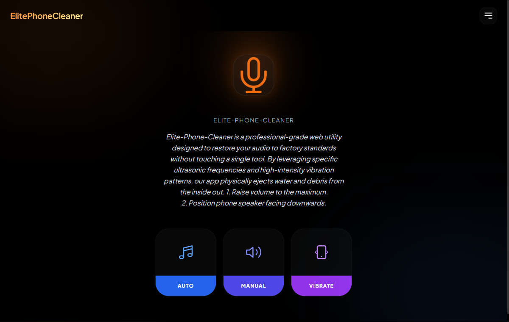

  
    
  
  &nbsp;&nbsp;
  
    
  
  &nbsp;&nbsp;
  

## Profile

I'm a **Nairobi-based frontend engineer and growth hacker** with **5+ years** of experience turning product ideas into fast, accessible web experiences — and turning traffic into measurable outcomes. I work across the full funnel: UI architecture, Core Web Vitals, SEO, CRO, lifecycle campaigns, analytics, and the data work that proves what moved the needle.

I build with **TypeScript, React, and modern web tooling**, analyze with **SQL, Python, and Excel**, and lead delivery with a project manager's bias for clarity. I've also worked in **AI training and evaluation**, technical support, data entry, virtual assistance, and executive support — which means I'm comfortable with ambiguity, documentation, and the unglamorous work that makes launches succeed.

**Currently:** freelancing on growth and web projects, open to full-time roles, and working remotely from **Nairobi, Kenya (EAT, UTC+3)**.

## What I Bring

| Focus | Capabilities |
| :--- | :--- |
| **Frontend&nbsp;Engineering** | Production interfaces in HTML, CSS, JavaScript, TypeScript, and React. Responsive layouts, accessible components, UI/UX detail, and performance-minded delivery. |
| **Growth & Digital Marketing** | SEO, CRO, landing pages, paid social, content, lifecycle campaigns, funnel analysis, A/B testing, and analytics instrumentation that connects acquisition to conversion. |
| **Data & Analytics** | SQL, Python, and Excel for reporting, cohort analysis, dashboards, and decision-ready insight from messy data. |
| **Delivery & AI** | Project management, technical support, data entry, virtual assistance, executive support, and AI training/evaluation workflows that keep teams shipping responsibly. |

## Toolbox

**Frontend Engineering**  

  
  &nbsp;&nbsp;
  
  &nbsp;&nbsp;
  
  &nbsp;&nbsp;
  
  &nbsp;&nbsp;
  
  &nbsp;&nbsp;
  
  &nbsp;&nbsp;
  
  &nbsp;&nbsp;
  

Responsive interfaces, component systems, accessibility, and performance-first delivery.

**Data & Backend**  

  
  &nbsp;&nbsp;
  
  &nbsp;&nbsp;
  
  &nbsp;&nbsp;
  
  &nbsp;&nbsp;
  
  &nbsp;&nbsp;
  
  &nbsp;&nbsp;
  
  &nbsp;&nbsp;
  

SQL, Python, Excel, reporting, dashboards, API integration, and AI evaluation workflows.

**Growth & Marketing**  

  
  &nbsp;&nbsp;
  
  &nbsp;&nbsp;
  
  &nbsp;&nbsp;
  

SEO, CRO, analytics, paid social, content, and lifecycle campaigns.

**Design & Delivery**  

  
  &nbsp;&nbsp;
  
  &nbsp;&nbsp;
  
  &nbsp;&nbsp;
  
  &nbsp;&nbsp;
  
  &nbsp;&nbsp;
  

UI/UX, project management, documentation, and cross-functional team workflows.

Technology icons from <a href="https://devicon.dev">Devicon</a>. Badges generated with <a href="https://www.npmjs.com/package/badge-maker">badge-maker</a>.

## Featured Work

### [Elite Speaker Cleaner](https://github.com/stephublabs/elite-speaker-cleaner) · [Live demo](https://elitephonecleaner.netlify.app/)

**A browser-based ultrasonic cleaner for phone speakers — no app, no tools, no guesswork.**

  

Built as an installable PWA with React 19, TypeScript, Vite, Tailwind CSS, and the Web Audio API. The app generates 4–20 kHz tones and precision vibration patterns to help eject dust and water, then guides the user through Auto, Manual, and Vibrate cleaning modes.

- **Audio engineering:** Web Audio API signal generation with frequency, intensity, and duration controls from 4–20 kHz.
- **Product experience:** Real-time waveform visualization, glassmorphic UI, dark/light themes, and a responsive mobile and desktop flow.
- **Engineering quality:** TypeScript end to end, a modular audio service, installable PWA delivery, and Netlify deployment.
- **Public repository:** Documented architecture, clear project structure, and a live product available to test.

  
  &nbsp;
  
  &nbsp;
  

[View the live product](https://elitephonecleaner.netlify.app/) · [Read the source](https://github.com/stephublabs/elite-speaker-cleaner)

> Most client work is private. I'm happy to walk through relevant code, architecture, and outcomes in a conversation.

## Certifications

  
  &nbsp;&nbsp;
  
    
  
  &nbsp;&nbsp;
  

  
  &nbsp;&nbsp;
  
    
  
  &nbsp;&nbsp;
  

  Certificates available on request.

## GitHub Activity

  

  
  &nbsp;&nbsp;
  

  Public GitHub activity only. Most client repositories are private, so these widgets understate day-to-day output.

## Let's Build Something Measurable

I'm available for **freelance engagements** and **full-time roles** in frontend engineering, growth, project management, and product analytics. If you need someone who can ship the interface, instrument the funnel, and explain the numbers, let's talk.

  
  &nbsp;
  

  Nairobi, Kenya · EAT (UTC+3) · Remote-ready

  <em>"Live today as if it were your last day on earth. Learn as if you were to live forever."</em>

